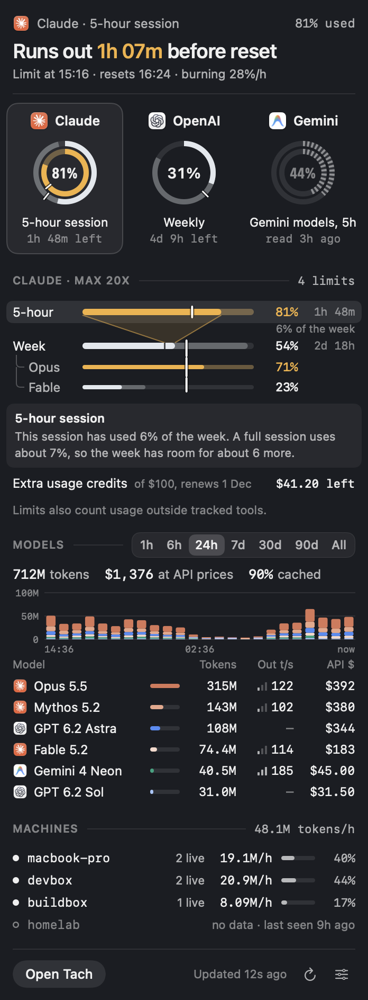
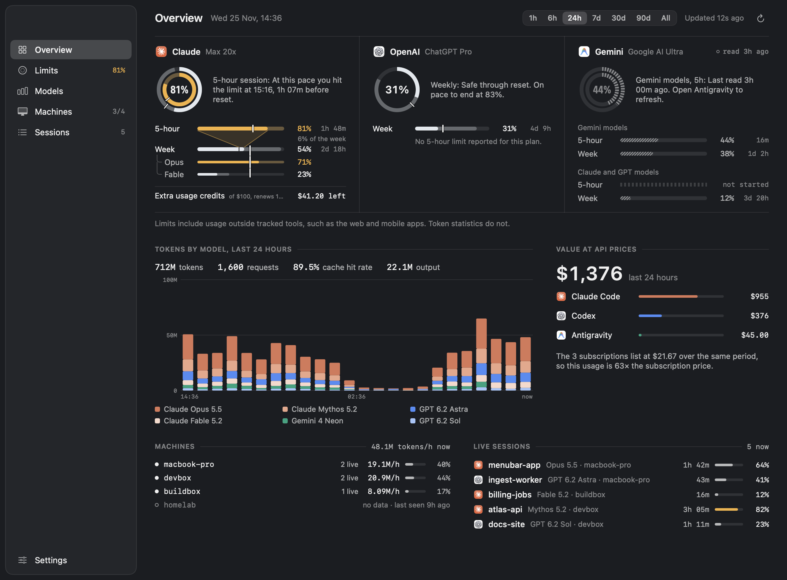
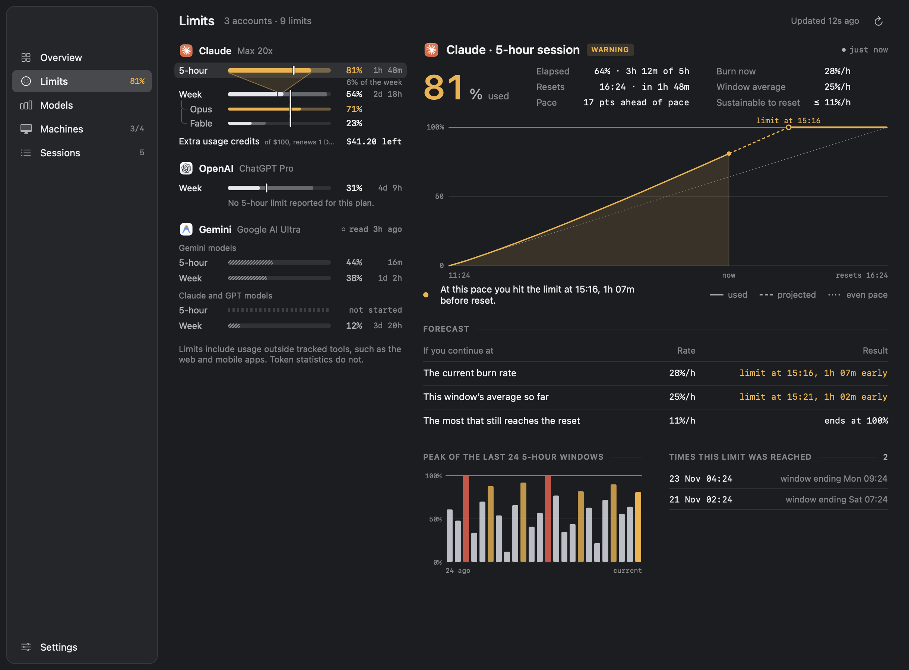
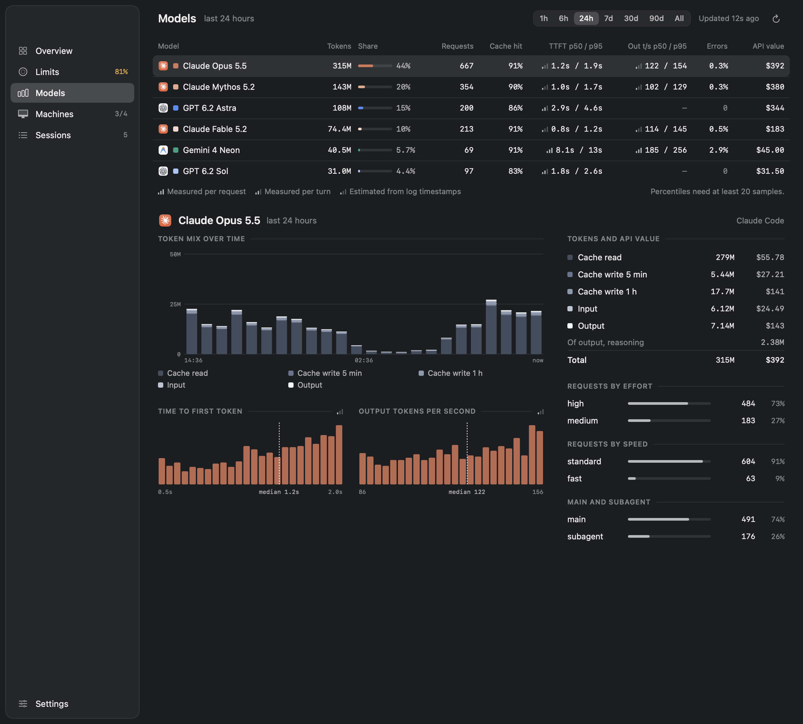
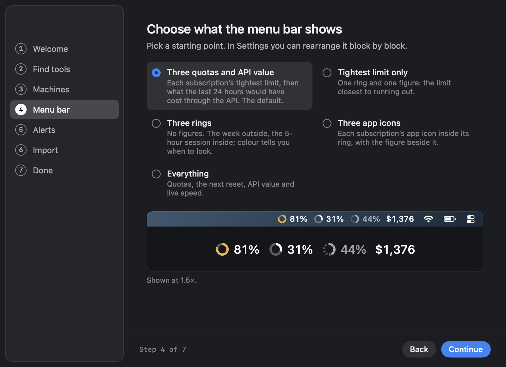
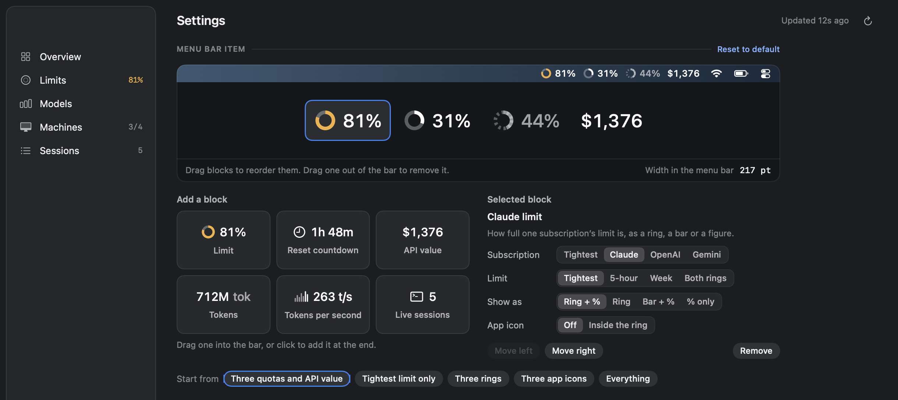

# Tach

A macOS menu bar app that shows how much of each AI coding subscription you have used, when the limits reset, and whether you will run out first. It also keeps usage statistics for every model, across every machine you code on.

Tach reads the logs that Claude Code, Codex and Antigravity already write. It needs no API keys and no proxy, and nothing leaves your machines.

<p align="center"></p>

<p align="center">
  
  &nbsp;
  
</p>

*Screenshots use the built-in sample data (`TACH_DEMO=1`).*

## What it shows

- **Limits** for Claude, OpenAI (Codex) and Gemini (Antigravity): every window the provider reports, percent used, time to reset, pace against an even burn, and a projection ("runs out 56m before reset" or "safe through reset"). A 5-hour session is drawn above the week it draws on, with model-specific limits nested under their week.
- **Models**: tokens (input, cache read, cache write at 5 minutes and 1 hour, output, reasoning), cache hit rate, time to first token, output tokens per second, error rate and what the usage would have cost at API prices. Ranges from the last hour to all time.
- **Machines**: this Mac plus any machine reachable over SSH, each with its share of usage and live sessions.
- **Menu bar item**: a row of blocks you arrange by dragging in Settings. The default is each subscription's tightest limit and the 24-hour API value.

## Screens

| Limits | Models |
|---|---|
|  |  |
| **Setup** | **Menu bar editor** |
|  |  |

## Install

Download the DMG from [Releases](../../releases), open it and drag Tach to Applications. It runs on macOS 14 or later, on Apple silicon and Intel.

Tach is not notarized yet, so macOS blocks the first launch. Open it from **System Settings → Privacy & Security → Open Anyway**, or run:

```sh
xattr -dr com.apple.quarantine /Applications/Tach.app
```

First-run setup finds your tools, offers the hosts in your SSH config, and imports the last 30 days.

If your menu bar is already full, macOS hides new items. Tach notices, shortens its item, and if that is not enough claims a place near the system icons. Command-drag it to move it.

### Build from source

Requires Xcode 26 (or its command line tools) and Go 1.25.

```sh
./scripts/build.sh            # build/Tach.app, ad-hoc signed
./scripts/make-dmg.sh         # build/Tach-<version>.dmg
open build/Tach.app
```

`TACH_UNIVERSAL=1` builds for both architectures and `TACH_VERSION` sets the version.

## How it gets the data

| | Usage per request | Limits |
|---|---|---|
| Claude Code | session transcripts in `~/.claude/projects` | the `claude` CLI's own usage request, then the usage endpoint with the stored sign-in |
| Codex | rollouts in `~/.codex/sessions` and its archives | readings Codex writes into its rollouts, then the ChatGPT usage endpoint |
| Antigravity | per-conversation databases in `~/.gemini/antigravity` | the local language server, while Antigravity is running |
| Gemini CLI | chat logs in `~/.gemini/tmp` | none reported |

A small Go program, `tach-collector`, does all the reading and prints compact events; the app stores them in SQLite under `~/Library/Application Support/Tach`. The contract between the two is in [docs/collector-protocol.md](docs/collector-protocol.md), and what was verified about each source is in [design/data-sources.md](design/data-sources.md).

Latency figures differ in quality and are marked: Antigravity logs them per request, Codex per turn, and for Claude Code they are estimated from log timestamps.

### Other machines

Add a machine in Settings with whatever you would pass to `ssh`. Tach copies the collector to `~/.cache/tach` on it and runs it, niced, each minute. There is no service, no open port and no root. Limits belong to the account, so a machine shows only its share of usage.

### Privacy

- Prompts, responses, code and tool output are never read into an event. The only strings taken from logs are model ids, session ids and working directories.
- Sign-ins are used only to ask each provider for your own usage. Tach never stores, refreshes or forwards them.
- Everything is read-only: no tool's data, config or credentials are written.
- These sources are not public APIs. They can change without notice, and Tach degrades to the last reading it has.

## Development

```sh
cd collector && go test ./...          # parsers, limit mapping, cursors
cd app && swift test                   # store, aggregation, limit maths, alerts
TACH_DEMO=1 swift run Tach             # the app on a built-in sample dataset
TACH_DEMO=1 TACH_SNAPSHOT=/tmp/shots swift run Tach   # render every screen to PNG and exit
```

Other environment variables: `TACH_HOME` (data folder), `TACH_COLLECTOR_DIR` (where the collector binaries are), `TACH_OPEN=window|panel|setup`, `TACH_DEBUG=1` (timing log on stderr).

CI runs both test suites and builds the app on every push. Pushing a tag such as `v0.2.0` builds a universal DMG and publishes it as a release.

Layout: `collector/` is the Go collector, `app/Sources/TachCore` the store and maths, `app/Sources/Tach` the SwiftUI app, `design/` the mockups and research.

## Limits of what it knows

- Usage in the web and mobile apps moves your limits but is not in any local log, so it shows in limits and not in token statistics.
- Antigravity's limits can only be read while Antigravity is running on some machine Tach collects from.
- API prices come from a bundled copy of [LiteLLM's price table](https://github.com/BerriAI/litellm) (MIT), which you can edit in Settings; run `scripts/update-prices.py` to refresh it. Models without a price are counted in tokens and left out of the value.

## Licence

MIT. See [LICENSE](LICENSE).
